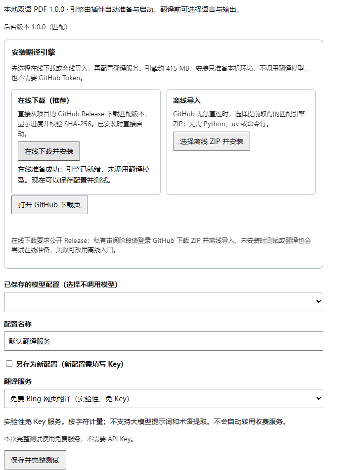
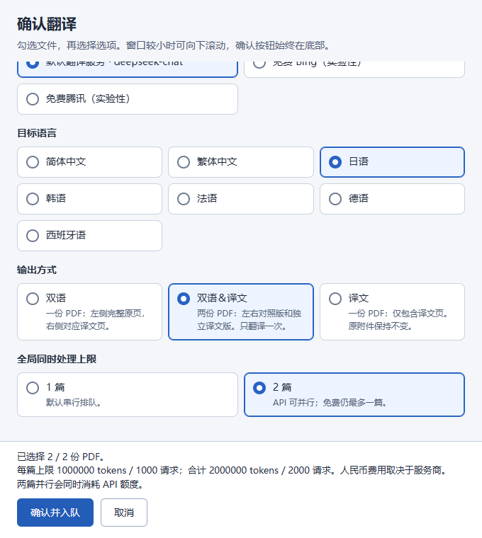

# Local Bilingual PDF

[简体中文](README.md) · [Download 1.1.1](https://github.com/Makashibata02/zotero-local-bilingual/releases/tag/v1.1.1) · [User manual (Chinese)](docs/使用手册.md)

Translate research papers and lecture PDFs inside Zotero. Keep original pages, figures, and mathematical objects, and create a bilingual reading PDF or a translated-only PDF. Use experimental keyless translation services or your own model API.

Platforms: **Windows 10/11 x64 and macOS 14+ (Apple Silicon / Intel)**. One shared XPI selects a platform-specific engine. The package declares Zotero 7–10 compatibility; native Mac validation used Apple Silicon with Zotero 10.0.6. The Intel candidate still needs native validation.

## Features

- **Full-page comparison:** complete original page on the left, corresponding translation on the right, with layout, figures, and formulas preserved where possible.
- **Free services or your API key:** experimental Bing/Tencent translation, DeepSeek, and custom OpenAI-compatible APIs, with multiple named model profiles.
- **Seven target languages:** Simplified Chinese by default; Traditional Chinese, Japanese, Korean, French, German, and Spanish.
- **Three output choices:** bilingual, translated-only, or both PDFs from one translation pass.
- **Document queue:** serial by default, optionally up to two concurrent documents; at most one free-service task runs at a time.
- **Task workbench:** titles, attachments, stages, progress, usage, cancellation, resume, results, search, and history management.
- **Usage protection:** cumulative limits pause a task until you approve an increase.
- **Managed installation:** online download or offline ZIP import, without installing Python, uv, BabelDOC, or running terminal commands.


## Install and translate

1. Download `zotero-local-bilingual-1.1.1.xpi` from the [Release](https://github.com/Makashibata02/zotero-local-bilingual/releases/tag/v1.1.1). In Zotero, use Tools → Plugins → Install from File, select the XPI, and restart.
2. Open Settings → Local Bilingual PDF and choose **online download and installation** at the top. The plugin downloads the matching engine directly from this project’s GitHub Release, verifies it, and installs it. No manual ZIP download or GitHub token is needed.
3. Select a free service or enter your API endpoint, model, and key. Click **Save and test**, then follow the feedback below the button.
4. Select PDFs or bibliographic items, right-click **Translate PDF…**, review files, service, language, output, and queue settings, then confirm submission.



The engine download is about **415–430 MiB**, with an installed size of about **884–933 MiB**, depending on the platform. Online installation includes progress, resumable downloads, and SHA-256 verification. **Offline alternative:** if GitHub downloads are restricted, obtain the matching `zlb-engine-1.1.1-windows-x64.zip`, `zlb-engine-1.1.1-macos-arm64.zip`, or `zlb-engine-1.1.1-macos-x64.zip` from the same Release and choose offline import at the top of settings. Offline import installs the runtime; translation still connects to your selected service.

Installing the engine makes no translation request. Initial configuration checks the full pipeline with a one-page PDF; later saves check the service connection once. Using your model API consumes a small amount of usage, disclosed next to the button. Each operation has feedback directly below its button.

## Choose a service

| Service | Configuration | Use |
|---|---|---|
| Free Bing/Tencent | Select the service; no key | Reading; experimental web endpoints can change or rate-limit requests |
| DeepSeek | Select the preset and enter your key and model | Translate using your own account |
| Custom compatible API | Enter endpoint, model, and key | Connect to an OpenAI-compatible service |

Save named API profiles and choose “profile name · model” before translating. Switching saved profiles does not call a model automatically. Free mode does not use LLM prompts or glossary hints. API mode offers custom instructions, glossary entries, page ranges, fonts, and usage limits in advanced settings.

## Languages and outputs

The default target is **Simplified Chinese**. Choose Traditional Chinese, Japanese, Korean, French, German, or Spanish instead. Unsupported options are disabled according to the selected service's capabilities.



| Output | Files |
|---|---|
| Bilingual (default) | One PDF with full original and translated pages side by side |
| Translated-only | One translated PDF |
| Both | Both PDFs from a single translation pass |

The main PDF is selected by default for bibliographic items; supplements can be selected separately. Leave the page range empty for the full document or enter a range such as `1-3,8` in advanced settings. Cancelling confirmation submits no task.

Results are attached to the original bibliographic item while the source attachment remains intact. Filenames include author, year, title, language, output kind, and service/model:

```text
Tachella et al. - 2025 - UNSURE_zh-CN_dual_deepseek-chat.pdf
```

`dual` means bilingual; `mono` means translated-only.

## Queue, progress, and usage

Submit multiple PDFs together. Serial processing is the default; enabling two concurrent documents lets two API tasks consume usage at the same time. At most one free-service task runs at a time.

The workbench opens automatically with paper titles and filenames. Narrow windows use task cards; expand details for full information. Closing the workbench does not cancel translation. Hiding finished history changes the list only and preserves files, caches, and cumulative usage.

API tasks default to **1,000,000 tokens and 1,000 requests per document**; free tasks default to **1,000,000 characters and 2,000 requests**. Lower these limits in advanced settings. A token limit is not a fixed monetary budget; prices depend on your provider. Tasks pause at their limits and continue only after you approve an increase. Resuming never resets cumulative usage.

## Data and privacy

API keys are stored in **Windows Credential Manager or macOS Keychain**. Settings, jobs, outputs, and caches live under `%LOCALAPPDATA%\ZoteroLocalBilingual` (Windows) or `~/Library/Application Support/ZoteroLocalBilingual` (Mac), outside the source repository. The backend listens only on loopback.

Text for translation is sent to your selected service. Free translation also uses remote endpoints; the local engine handles PDF extraction, typesetting, and tasks. Check the provider's data policy before using sensitive documents.

## Limitations

Free web endpoints may change, rate-limit requests, or require verification. Failure never switches automatically to a paid API. Google and CNKI are not included.

References, detected author rows, and mathematical objects are preserved. Complex formulas, text inside figures, scanned PDFs, and multi-column reading order may be incomplete; compare outputs with the original. Source annotations are not migrated.

## Documentation and development

- [User manual (Chinese)](docs/使用手册.md): profiles, recovery, pages, prompts, and common issues.
- [Developer guide (Chinese)](docs/开发说明.md) · [Contributing](CONTRIBUTING.md) · [Security](SECURITY.md).

## License

[AGPL-3.0-or-later](LICENSE). BabelDOC, PyMuPDF, models, fonts, and other components retain their respective licenses; see [third-party notices](THIRD_PARTY.md). This project is not affiliated with Zotero or translation providers.
