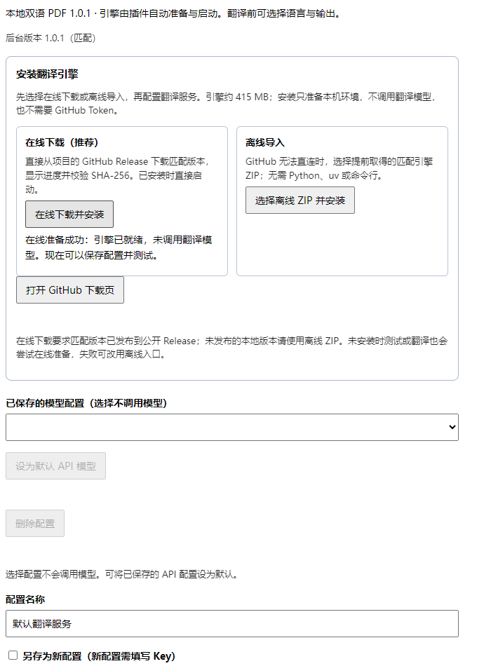
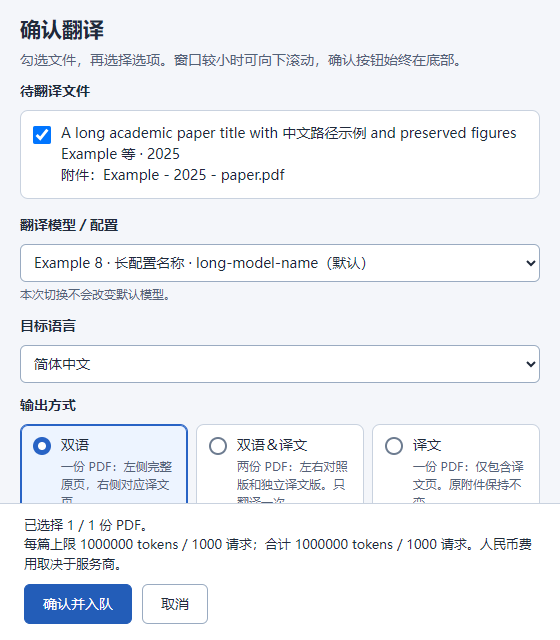
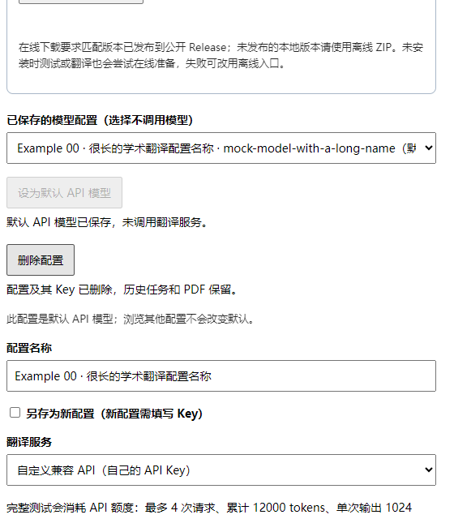
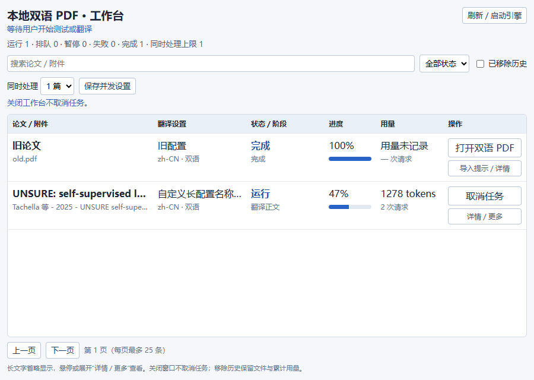

# 本地双语 PDF 1.1.2 使用手册

适用于 Windows 10/11 x64 和 macOS 14+。Windows 与 Apple Silicon Mac 已通过用户实机验证；Intel Mac 引擎已提供，尚未实机验证。详见 [Mac 安装与使用](macOS安装与验收.md)。保留 Zotero 原附件；Key 存放在系统凭据管理器／钥匙串。需安装插件与对应版本、对应平台的引擎。

## 四步开始

1. Zotero“工具 → 插件 → 从文件安装插件”，选择 `zotero-local-bilingual-1.1.2.xpi`，重启 Zotero。
2. 在“设置 → 本地双语 PDF”（Mac 从菜单栏“Zotero → 设置”进入）顶部点击“在线下载并安装”，等待引擎就绪；选择免费服务或填写自己的 API 地址、模型、Key 和配置名称。
3. 点击“保存并完整测试”。首次部署用一页 PDF 检查环境和翻译；成功后按钮变为“保存并测试连接”，只实际调用一次服务，不再翻译 PDF。
4. 右键 PDF 或文献条目，选择“翻译 PDF…”，在确认窗口选择模型、语言与输出，点击“确认并入队”。

## 在线下载或离线导入

默认使用在线安装，直接从项目 Release 下载匹配引擎，无需 GitHub 登录或 Token。网络下载受限时使用旁边的离线 ZIP 入口。

引擎安装区在设置页顶部，默认可见，不需要展开高级选项。两个入口准备同一套匹配引擎，安装操作不调用翻译服务。

- **在线下载（推荐）**：点击“在线下载并安装”，直接从公开 GitHub Release 下载；不用 GitHub 登录或 Token。按钮下显示进度、校验、安装与启动状态。
- **离线导入**：点击“打开 GitHub 下载页”取得对应平台 ZIP（Windows 为 `zlb-engine-1.1.2-windows-x64.zip`，Mac 见 [Mac 说明](macOS安装与验收.md)），再点击“选择离线 ZIP 并安装”。取消文件选择不会启动安装。

引擎下载约 415–430 MiB，安装后约 884–933 MiB（随平台不同）；在线失败时可改用离线文件。哈希错误不能跳过，需重新取得正确文件。安装后服务自动启动，无需安装 Python、BabelDOC、运行终端或复制服务令牌。

升级至 1.1.2，需更新 XPI 和匹配平台的引擎。1.1.2 已在 GitHub 发布，可在线安装或离线导入。设置页显示插件及后台版本；旧服务有任务时先等待完成与空闲退出再更新，不强制取消翻译。Key、正式文件和累计预算保留。

从 0.2.x 升级时，如果旧后台还在运行，请等其任务结束、十分钟空闲退出，再导入新版。旧未完成任务升级后暂停，手动恢复；旧 Key、原件、缓存与累计预算保留。新默认上限不自动扩大旧任务的额度。从 0.1.x 升级需关闭原 PowerShell 服务一次。

## 后台版本切换

1.0.2 起，空闲托管后台可由插件安全退出，再启动匹配引擎；同版本离线重导入也适用。运行、排队、上传或连接测试未结束时不会停止后台。加载已初始化的默认配置不再重新计时。

1.0.0／1.0.1 后台不支持安全退出接口，首次切换仍需让旧服务自然退出：停止操作插件后等待约十分钟，或重启电脑。只重启 Zotero 不会关闭独立 Python 后台。错误提示会明确区分“当前空闲但不支持自动退出”和“仍有任务／请求”。不要删除任务库、凭据或服务锁来绕过保护。

## 翻译前确认

确认窗口默认选择指定的 API 模型、简体中文和双语输出。确认后工作台立即打开，显示上传入队及后续阶段、进度条；旧搜索筛选会清除以显示当前任务。也可从设置中手动打开工作台。若没有弹出，不要反复提交同一文件，先查看工作台提示。[修复记录](验收记录.md)

单篇显示论文标题、作者年份和真实附件名；多篇可勾选文件。选择文献条目时默认勾选主 PDF，补充附件可另选；插件生成的译文不默认选入。直接选择一个 PDF 会保留该选择。

通过模型下拉框选择“配置名称 · 模型”，也可选免费 Bing、腾讯；目标语言使用独立下拉框。临时切换不会改变设置页指定的默认模型。输出和并发继续使用单选卡片。窗口较小时向下滚动，确认／取消按钮固定在底部。简体中文和双语为每次确认的默认值；另提供繁体中文、日语、韩语、法语、德语和西班牙语。可用语言以所选服务为准，未支持的选项禁用；免费接口在其他网络环境可能限流或失效。

| 输出选择 | 实际产物 |
|---|---|
| 双语 | 左完整原页、右译文整页的 PDF |
| 译文 | 独立译文 PDF |
| 双语＆译文 | 上述两份 PDF；只翻译一次 |

取消确认不上传 PDF、不创建翻译任务、不调用翻译服务。引擎准备和读取已保存配置不产生翻译调用。

文件名采用 `作者等 - 年份 - 标题_语言_输出类型_模型.pdf`，例如 `Tachella 等 - 2025 - UNSURE_zh-CN_dual_deepseek-chat.pdf`。`dual` 为双语，`mono` 为译文；免费服务末尾为 `bing`／`tencent`。保留标题大小写，过滤 Windows 禁用字符；过长标题截短以兼容路径限制。Zotero 中附件标题另带任务与产物标识，用于查重。

## 保存多套模型

填写配置名称后保存，可从“已保存的模型配置”切换；选择配置不会自动测试模型。勾选“另存为新配置”创建另一套 API 配置，新配置需填写自己的 Key。现有配置的 Key 留空表示保留。

选中具有 Key 的已保存 API 配置，点击“设为默认 API 模型”。列表会标注“默认”，浏览其他配置或保存另一套配置不会替换它。首次升级优先保留当前有效 API 配置为默认；没有 API 时默认使用免费 Bing。设为默认不会测试模型或产生翻译费用。

点击“删除配置”后核对名称和模型，再确认同时删除其系统凭据管理器／macOS 钥匙串中的 Key。历史任务、PDF、缓存与费用审计保留。删除默认配置时会在确认框说明替代默认模型；没有其他 API 时回到免费 Bing。普通失败或取消任务在删除配置后不能直接恢复，需要重新配置并重新发起翻译。

排队、运行、取消中、暂停或等待追加额度的任务会阻止删除；先在工作台结束对应任务。连接测试进行中也不能删除。凭据访问失败会报告删除失败，不显示成功。按钮下方分别显示操作结果。

运行、排队或等待追加额度的任务所引用的配置不能覆盖，使用“另存为新配置”即可。相同配置原样保存可用于连接测试。更换服务不会把旧免费任务悄悄转入收费 API。

## 队列与工作台

一次可选择多篇论文。文件依次上传后立即入队，不等待上一篇翻译完成。默认串行；确认窗口可主动开启最多两篇并行，免费任务始终最多一篇运行。同一 API 配置在多个进程间共享请求速率。改回一篇时不会中断已运行的任务。

工作台自动适应窗口宽度：较宽窗口为紧凑表格，窄窗口为任务卡片。标题、附件名、模型名过长时显示省略号；悬停或展开“详情／更多”查看完整信息和累计预算。进度、用量和主要操作直接可见，次要操作在详情中；展开状态随进度刷新保留。可搜索、筛选、分页，无需拖动列宽或横向滚动。

取消、恢复、追加额度和打开结果的反馈在各按钮下方。双产物分别有打开入口。完成后的正式产物自动加入原文献条目，以任务和产物标识查重；重新打开、刷新不会重复导入。关闭窗口不取消翻译；后台任务结束后十分钟无操作自动退出，轮询不会延长时间。

完成、失败、取消的正式记录可“从列表移除”，只隐藏记录，不删除文件、缓存或费用审计。勾选“显示已移除历史”可恢复；排队、运行、暂停记录不能直接隐藏。

## 额度与测试

**新 API 任务默认每篇累计 100 万 tokens、1000 次请求。** 这是最大允许用量，不是一次扣费，也不是人民币硬预算。确认窗口显示所选论文的合计上限；两篇并行会同时消耗额度。高级选项可以降低上限。

请求前预留输入与输出额度；中断后的未知用量仍保留，恢复不会清零。达到上限仅暂停该任务，工作台可填写新累计上限并明确确认继续；取消确认保持暂停。高级设置只影响新任务，不能替代旧任务的追加确认。

免费模式默认每篇 2000 次请求、100 万字符；最多 800 字符每次，至少两秒间隔，缓存命中不增加请求计数。达到上限不会切换收费服务；网页接口失效时手动换服务。免费模式不使用大模型提示词、自动术语提取和固定术语提示。Google、知网未接入。

首次 PDF 测试仍最多 4 次 API 请求、累计 12000 tokens、单次输出 1024 tokens，不提供付费追加；成功后日常连接测试最多调用一次 API、最多输出 32 tokens，或翻译一个免费短句。测试按钮旁标明计费说明，失败不会后台反复测试。

成功首次测试先打开专用临时查看副本，再清理服务端测试原文、产物和任务缓存，保留最小状态与用量记录。下次 Zotero 启动清理查看副本，“打开测试 PDF”会提示文件已清理，不会自动重新测试。复制或打开失败则保留服务端文件；占用时待清理重试。失败测试保留诊断，从列表移除该测试时才清理。正式附件和共享缓存不受影响。

## 高级选项与限制

页码留空为全文，可填 `1-3,8`；所选产物仅含所选页。提示词、术语、字体和用量限额需点击“保存高级选项”。API 术语表用 `英文=译名`；换目标语言时需检查术语与自定义提示词是否仍适用。自动提取术语默认关闭。

参考文献、识别出的作者行和数学对象保留原文，正文和附录继续翻译。免费模式另保护明确的作者名单及短独立公式；复杂 PDF 的区域识别仍可能出错。图内文字不保证翻译，不迁移原附件批注。成品属于批量阅读版，不能替代全面学术校订；检查复杂公式、否定句和双栏阅读顺序。

每个按钮下方都有结果。如果提示版本不匹配，导入匹配的引擎 ZIP；哈希错误需重新取得正确文件，不能跳过校验。免费服务限流、验证码或失效时停止任务并手动换服务；无法恢复时保留任务 ID 和详情。

实际测试与尚未验收的内容见 [当前验收记录](验收记录.md)。本轮 Zotero 原生界面由用户手动验收，自动化检查不等同于实际 UI 检查。

紧凑工作台安装及检查说明见 [0.3.0 紧凑工作台](验收记录.md)。
